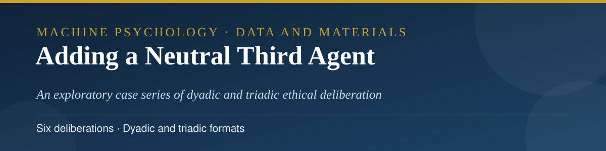
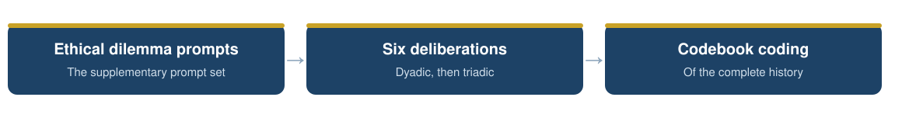
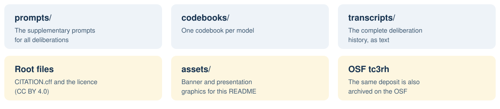

<p align="center">
  
</p>

<p align="center">
  
  
  
  <a href="LICENSE"></a>
</p>

<p align="center">
  
</p>

<p align="center">
  <a href="prompts">Prompts</a> · <a href="codebooks">Codebooks</a> · <a href="transcripts">Transcripts</a>
</p>

# Adding a Neutral Third Agent to LLM Deliberation: Data and Materials

Data and materials for the article:

> Hamidavi, A. *Adding a Neutral Third Agent to LLM Deliberation: An Exploratory Case Series of Six Dyadic and Triadic Ethical Deliberations.* Submitted to *Ethics and Information Technology*, November 2026. A preprint is in preparation with Research Square. The same materials are also deposited on the Open Science Framework: [osf.io/tc3rh](https://osf.io/tc3rh/).

<p align="center"></p>

## 📖 About the study

The study is an exploratory case series of six ethical deliberations run with persona-primed language-model agents (GPT-5.4, Claude 4.6 Sonnet, and Gemini 3.1 Pro). Each deliberation places two agents with opposed professional value commitments in front of a forced allocation decision (an intensive-care bed, research funding, a single transplant slot, and related scenarios). The series compares dyadic deliberations with triadic ones, in which a third agent with a neutral professional role joins, and examines majority pressure, strategic conformity, and resistance across the two formats.

<p align="center">
  
</p>
## 🗂️ Contents

<p align="center">
  
</p>

| Folder | Contents |
| --- | --- |
| [`prompts/`](prompts) | The complete supplementary prompt set: the verbatim persona (priming) prompts and scenario (kick-off) prompts for all six experiments. |
| [`codebooks/`](codebooks) | The three per-model coding codebooks (plain-text renderings of the archived PDFs in the OSF deposit). |
| [`transcripts/`](transcripts) | The complete deliberation history (plain-text rendering of the archived PDF in the OSF deposit). |

## 🔍 What this deposit does not contain

> [!IMPORTANT]
> As stated in the article, the turn-level feature table, the analysis scripts, and one second-rater matrix set were not retained after the study's original analysis phase. They cannot be reconstructed and are not part of this deposit. Everything that survives from the study's archive is included here and on OSF.

<p align="center"></p>

## 📚 Citation

Please cite the article. Citation metadata is provided in [CITATION.cff](CITATION.cff).

```bibtex
@article{hamidavi2026thirdagent,
  author  = {Hamidavi, Abbas},
  title   = {Adding a Neutral Third Agent to LLM Deliberation:
             An Exploratory Case Series of Six Dyadic and Triadic
             Ethical Deliberations},
  journal = {Ethics and Information Technology},
  year    = {2026},
  note    = {Manuscript submitted}
}
```

## 🔗 Access to the article

- **OSF deposit:** [osf.io/tc3rh](https://osf.io/tc3rh)
- **Journal:** submitted to *Ethics and Information Technology*; the publisher link will be added here if the article is published.
- A preprint is in prescreening at Research Square; its public link will be added here as soon as it posts.

## ⚖️ Licence

The contents of this repository are released under the Creative Commons Attribution 4.0 International licence (CC BY 4.0, see [LICENSE](LICENSE)).

The deliberation transcripts are outputs of publicly available AI systems, generated for this study in response to fictional scenarios. They contain no personal data.

## ✉️ Contact

Abbas Hamidavi
Department of Computer Engineering, Mashhad Branch, Islamic Azad University, Mashhad, Iran
ORCID: [0009-0001-7342-7844](https://orcid.org/0009-0001-7342-7844)

<p align="center">
  <a href="mailto:abbashamidavi2002@gmail.com"></a>
  <a href="https://github.com/AVABBAS"></a>
  <a href="https://www.linkedin.com/in/abbas-hamidavi"></a>
  <a href="https://scholar.google.com/citations?user=FWqAHkgAAAAJ&hl=en"></a>
  <a href="https://www.researchgate.net/profile/Abbas-Hamidavi"></a>
  <a href="https://orcid.org/0009-0001-7342-7844"></a>
  <a href="https://avabbas.github.io/academic-cv/"></a>
</p>

<p align="center">
  
</p>
